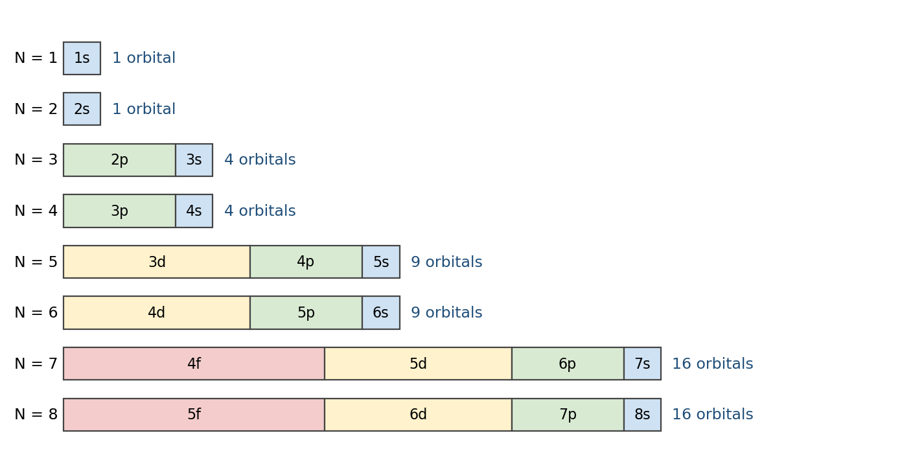
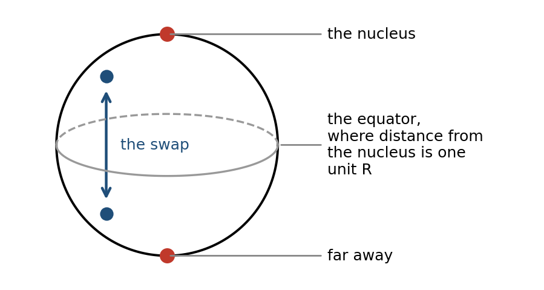
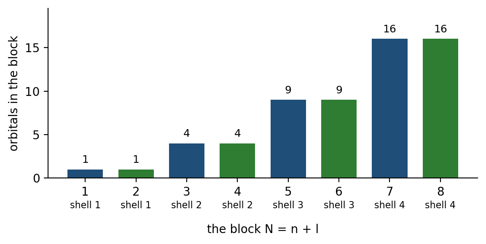
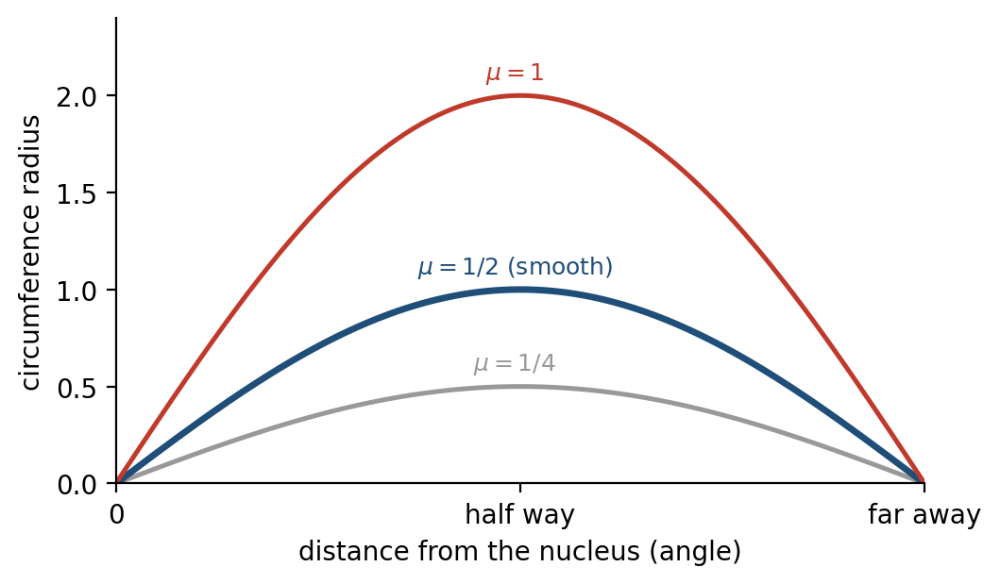

This is an introductory text to the research paper *The Demkov-Ostrovsky Madelung model as the circle-invariant conformal Laplacian of the round 4-sphere* [Per26], by the same author. The paper has the proofs. This note has the idea. No equations are needed to follow it. It makes no claim the paper does not make, and it says which claims are proved and which are only computed or checked.

One caution comes first, because the paper itself puts it first. This is about a **model**. It explains a neat piece of mathematics hiding inside a well-known model of the periodic table. It does not derive real atoms.

# A puzzling rule

Electrons in an atom sit in **shells**. Each electron has two labels, a number $n = 1, 2, 3, \dots$ for the shell and a letter for the shape of its orbit: $s$, $p$, $d$, $f$, which stand for $l = 0, 1, 2, 3$. For hydrogen, the energy depends on $n$ alone, and that is easy to understand.

In heavier atoms the order in which the levels fill up is stranger. The **Madelung rule** says: add the two labels, $N = n + l$. Levels with a smaller $N$ fill first. When two levels have the same $N$, the one with the smaller $n$ goes first. So $4s$ ($N = 4$) fills before $3d$ ($N = 5$), which is exactly what the periodic table shows.

The rule sorts the levels into **blocks** of equal $N$. Counting orbitals (without spin), the blocks have $1, 1, 4, 4, 9, 9, 16, 16, \dots$ members. Count two electrons per orbital, which is an assumption we come back to, and the blocks hold $2, 2, 8, 8, 18, 18, 32, 32$ electrons. These are the lengths of the periods of the periodic table, $2, 8, 8, 18, 18, 32, 32$, with one extra 2 at the start. The blocks are not exactly the periods, but the numbers are the same.

{width=85%}

Look at the numbers: $1, 1, 4, 4, 9, 9$. Perfect squares, each one twice. Why would the blocks be perfect squares? Nothing in the rule says so, and the squares are what a physicist calls a **hidden symmetry**: some extra structure, not visible in the problem as written, forces levels to sit together.

# The model of Demkov and Ostrovsky

In 1971 and 1972, the physicists Demkov and Ostrovsky wrote down a model that reproduces the $n + l$ grouping exactly [DO71, DO72]. An electron feels the pull of a nucleus whose strength is screened at a distance. Their model uses one particular shape for that pull, a field due to Tietz, and a simplification: look only at the solutions at zero energy, and read the strength of the pull as the number that must be tuned to find a solution. Those tuned values come in blocks, and the blocks are exactly the $n + l$ blocks.

They found the grouping by calculation. They also said that the model has a hidden symmetry group, the same kind of group of four-dimensional rotations that explains hydrogen. But they could build only its infinitesimal generators, and wrote that its finite transformations are unknown. So the squares had a calculation, but no picture.

# Hydrogen lives on a sphere

For hydrogen there is a picture, due to Fock in 1935 [Fock35]. After a change of variables, the hydrogen atom turns into free motion on the surface of a **3-sphere**, the three-dimensional skin of a four-dimensional ball. On a sphere, every direction is alike, and the symmetry is just rotation. The perfect squares $1, 4, 9, 16$ are then the standard counts of the vibration modes of the sphere.

The new result is the same kind of statement for the Madelung model. The paper proves, and this part is **proved**, that the Demkov-Ostrovsky problem is the same as a standard problem on a sphere, one dimension higher: the round **4-sphere**.

# One point of space, one circle of the sphere

The link between the two is an old trick called the **Kustaanheimo-Stiefel map**. It takes four-dimensional space and folds it onto ordinary three-dimensional space. Each point of ordinary space comes from a whole **circle** in the four-dimensional picture. To go back to the real, three-dimensional atom, we keep only the vibrations of the sphere that look the same all the way around each circle. These are the **circle-invariant** vibrations.

The paper proves that this describes the model exactly. The central object is the **conformal Laplacian**, the standard operator that gives the vibrations of a sphere, and the model is that operator on the circle-invariant functions of the 4-sphere. With this one fact, three things follow, and each is **proved**.

- **The levels.** The allowed values of the tuned strength are $Z_N = N(N+1)/(2R)$ for $N = 1, 2, 3, \dots$, with nothing else.
- **The block sizes.** The vibrations of the 4-sphere come in groups, one for each degree. Keeping only the circle-invariant ones leaves $1, 1, 4, 4, 9, 9, \dots$ in the successive groups. This is the Madelung count, with the labels $n + l = N$ attached. An independent computer count by exact linear algebra gives $1, 1, 4, 4, 9, 9, 16, 16, 25$.
- **The mirror.** Demkov and Ostrovsky had also noted an inversion symmetry: turning the space inside out around a sphere of radius $R$ maps a solution to a solution. On the 4-sphere this is the plain mirror reflection that swaps the two poles, the nucleus and the far-away point at infinity. It multiplies block $N$ by the sign $+1$ or $-1$, alternately.

{width=58%}

# Why the doubled squares

There is one more result, and it explains the doubling $1, 1, 4, 4, 9, 9$. Each block, seen as a set of orbitals that can be rotated, looks exactly like a **hydrogen shell**: block $N$ has the same pieces as the shell $n = \lfloor (N+1)/2 \rfloor$ of hydrogen. Block 3 and block 4 are both a copy of hydrogen's shell 2, which has 4 orbitals. Each shell shows up twice, once for each sign of the mirror. This is **proved**.

{width=62%}

The paper is honest about what this does and does not say. It explains the doubling inside the model. It is a relabelling, and it does not by itself produce the hidden symmetry that Demkov and Ostrovsky asked for.

# Why this particular model

Demkov and Ostrovsky wrote a whole family of models, labelled by a number $\mu$. The Madelung rule is the member $\mu = 1/2$. What is special about it? The paper answers in three ways, each **proved**.

- **It is the smooth one.** The four-dimensional picture of every member of the family is a sphere with a pointed tip at each pole, like a spindle. The tips are sharp for every $\mu$ except $1/2$. Only at $\mu = 1/2$ does the shape close up smoothly into a round sphere.
- **It is the only one with a bare Coulomb core.** Near the nucleus, the pull is the plain one-over-distance pull of electric charge only for $\mu = 1/2$.
- **It is the last one with a single clean dynamics.** For $\mu \le 1/2$ the equations have exactly one meaningful way to be solved. Above that, one has to choose.

{width=65%}

# What is not there, and why that matters

The paper proves a second statement in the other direction. The hidden symmetry that Demkov and Ostrovsky found for the other members of the family cannot act by simple moves of points of ordinary space. For every $\mu$ other than 1, the only moves of points that preserve the problem are rotations, mirror reflections, and the inversion. This is **proved**, and the proof is a short calculation. It rules out one kind of picture. It does not rule out the kind that hydrogen itself has, where the symmetry shows up after a transformation of the problem. So the question of the finite transformations that Demkov and Ostrovsky left open **stays open**. The paper lists it, with two other questions, as open.

One more result is a closed formula, valid for every value of the strength, for the Green's function of the problem. It tells how a disturbance at one point is felt at another. It is **proved**, and its numbers have also been **checked by computer** at many test points, including all values off the levels.

# What was checked and how

Every number in the paper, such as the block sizes, the levels of the family, the curvature, and the formulas for the Green's function, is tested by a script that anyone can run. The symbolic steps are checked by computer algebra. What the computer does not check are the parts of the proofs that need functional analysis, such as the claim that the operators are self-adjoint. Those rest on the proofs in the paper.

# What this note does not do

It does not prove anything. It does not derive real atoms, and the paper does not either. Three things are put in by hand and not derived: the factor of 2 electrons per orbital, the particular Tietz form of the nuclear field, the one that is unchanged by the inversion, and the idea of ordering the levels by the strength at zero energy. The Madelung rule itself is known to fail for very heavy atoms [BFHS25]. The novelty claims are all of the form "to our knowledge, in the sources we could consult", and the paper names the earlier works that bear on them.

# Where to go next

- The paper itself [Per26], with the proofs and the scripts.
- The original model [DO71, DO72].
- The hydrogen sphere that this work imitates [Fock35].

# References {-}

[BFHS25] A. Bjerg, S. Fournais, P. Hearnshaw and J. P. Solovej, *The angular momentum distribution of electrons in large atoms and its deviation from Madelung's rule*, 2025, [arXiv:2506.14227](https://arxiv.org/abs/2506.14227).

[DO71] Yu. N. Demkov and V. N. Ostrovsky, *Internal symmetry of the Maxwell "fish-eye" problem and the Fock group for the hydrogen atom*, Sov. Phys. JETP 33 (1971) 1083-1087.

[DO72] Yu. N. Demkov and V. N. Ostrovsky, *n+l filling rule in the periodic system and focusing potentials*, Sov. Phys. JETP 35 (1972) 66-69.

[Fock35] V. Fock, *Zur Theorie des Wasserstoffatoms*, Z. Phys. 98 (1935) 145-154, [doi:10.1007/BF01336904](https://doi.org/10.1007/BF01336904).

[Per26] M. Perreault, *The Demkov-Ostrovsky Madelung model as the circle-invariant conformal Laplacian of the round 4-sphere*, 2026, Zenodo. [doi:10.5281/zenodo.24522163](https://doi.org/10.5281/zenodo.24522163).

```{=latex}
\par\ifdim\dimexpr\pagegoal-\pagetotal\relax<15\baselineskip\ifdim\pagetotal>0pt\newpage\fi\fi
```

# Read the research paper {-}

```{=latex}
\raggedright
```

The full paper, with the proofs, is *The Demkov-Ostrovsky Madelung model as the circle-invariant conformal Laplacian of the round 4-sphere*, by Michaël Perreault.

DOI: [doi:10.5281/zenodo.24522163](https://doi.org/10.5281/zenodo.24522163)
